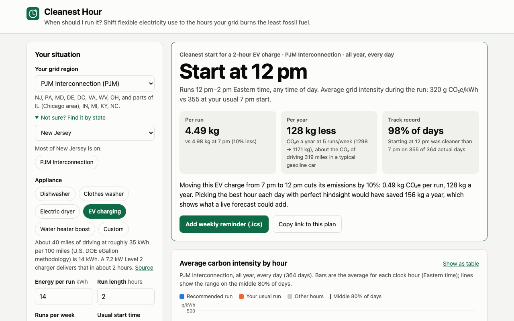

# Cleanest Hour

**When should I run it?** Cleanest Hour tells you when to start a dishwasher, laundry, a dryer, an EV charge or a water-heater boost so it runs on the cleanest electricity your U.S. grid typically produces. It then shows, in kg CO₂e, how much that saves per run and per year.

- **Live app:** https://bowen1314.github.io/cleanest-hour/
- **Demo video (2.5 min, captions, no audio):** [demo/demo.mp4](demo/demo.mp4) · [transcript](demo/transcript.md)
- Built during Green Shift Hacks, 2026-10-24 → 2026-11-17.



## Who it's for

Households with **flexible electric loads**: anything with a delay timer, or anything you can plug in later. That covers dishwashers, washers and dryers, EV chargers, and electric water heaters. They know *what* they run; they don't know *when* their grid is cleanest, and the common rule of thumb ("run it overnight") is wrong on solar-heavy grids.

## What it does

1. Pick your grid region (31 U.S. balancing authorities, including PJM for New Jersey, MISO, ERCOT, CAISO, SPP, NYISO and ISO-NE; or search by state).
2. Pick an appliance preset (energy per run and run length from ENERGY STAR / DOE figures, all editable), how often you run it, your usual start time and when it is allowed to run.
3. You get:
   - the **recommended start hour** with the lowest average carbon intensity over the run;
   - **kg CO₂e per run** at that hour vs. your usual time, and the **yearly saving**;
   - a **track record**: on how many of the last 365 actual days the recommended hour beat your usual hour;
   - an hourly intensity chart and the generation mix behind it, a **season-by-season plan**, and a comparison across all 31 grids;
   - a weekly **calendar reminder (.ics)** and a **shareable link** to the plan;
   - a **"How this is calculated"** panel with the formula, the exact emission factors for your region, the appliance assumptions and the limitations.

### What it finds (from the app's own calculation; reproduce with `node scripts/impact_table.mjs`)

PJM (New Jersey), usual start 7 pm, any start time allowed, Oct 2025 – Sep 2026:

| Appliance | kWh/run | Runs/wk | Cleanest start | kg/run at 7 pm | kg/run at best | Saving | kg CO₂e/yr saved | Cleaner on |
|---|---|---|---|---|---|---|---|---|
| Dishwasher | 1.1 | 4 | 12 pm | 0.39 | 0.35 | 10% | 8.0 | 98% of 364 days |
| Clothes washer | 0.4 | 4 | 12 pm | 0.14 | 0.13 | 9% | 2.7 | 97% of 365 days |
| Electric dryer | 2.2 | 3 | 12 pm | 0.78 | 0.70 | 9% | 11.3 | 97% of 365 days |
| EV charging (40 mi) | 14 | 5 | 12 pm | 4.98 | 4.49 | 10% | 127.8 | 98% of 364 days |
| Water heater boost | 4.5 | 7 | 12 pm | 1.59 | 1.44 | 9% | 53.9 | 97% of 365 days |

All five together: 203.8 kg CO₂e a year out of 2,111 kg (10%). If the EV can only charge overnight (10 pm – 7 am), the best start is 3 am: 5% less, 63.8 kg a year.

EV charging (14 kWh, 2 h, 5×/week, usual 7 pm) on the seven large grid operators:

| Grid | Cleanest start (any time) | Saving | kg/yr | Cleaner on | Best overnight start | Overnight saving | Overnight kg/yr |
|---|---|---|---|---|---|---|---|
| PJM | 12 pm | 10% | 127.8 | 98% | 3 am | 5% | 63.8 |
| MISO | 12 pm | 16% | 261.2 | 96% | 2 am | 6% | 102.6 |
| ERCOT | 11 am | 38% | 470.0 | 99% | 1 am | 7% | 90.6 |
| CAISO | 10 am | 54% | 325.7 | 99% | 10 pm | −1% | −7.0 |
| SPP | 1 am | 14% | 218.2 | 70% | 1 am | 14% | 218.2 |
| NYISO | 3 am | 5% | 46.4 | 72% | 3 am | 5% | 46.4 |
| ISO-NE | 11 am | 13% | 121.5 | 89% | 2 am | 12% | 114.0 |

The headline finding: the right hour depends on the grid. On solar-heavy grids (California, Texas) midday is 38–54% cleaner than 7 pm, while overnight is barely better or even worse. On wind-heavy SPP the night is cleanest. On PJM the gain is real but modest, about 10%.

## How it works

**Data, built offline once and served as static JSON** (`scripts/build_data.py`, ~1.2 MB in `data/`):

1. **Hourly generation by source**: [EIA-930 Hourly Electric Grid Monitor](https://www.eia.gov/electricity/gridmonitor/) six-month "BALANCE" files `EIA930_BALANCE_2025_Jul_Dec.csv`, `EIA930_BALANCE_2026_Jan_Jun.csv` and `EIA930_BALANCE_2026_Jul_Dec.csv`, downloaded 2026-10-24 (server Last-Modified 2026-10-24 14:39–14:40 UTC). We use the 12 complete months 2025-10-01 to 2026-09-30, EIA's *adjusted* columns. SHA-256 hashes are in `data/index.json`. EIA revises these files, so a rebuild later may differ slightly.
2. **Emission factors**: [EPA eGRID2023](https://www.epa.gov/egrid) data file, revision 2 (`egrid2023_data_rev2.xlsx`, June 2025), balancing-authority sheet, CO₂-equivalent output emission rates:
   - coal and gas: that BA's own eGRID coal / gas rate (U.S. rate if the BA has none);
   - oil: the BA's oil rate if it lies within 1,000–3,500 lb/MWh, otherwise the U.S. oil rate (several BAs report implausible values, e.g. 63,048 or negative);
   - other/unknown fuels and storage discharge: the BA's overall annual average rate;
   - nuclear, hydro, wind, solar, geothermal: 0 (no combustion).

   *Why eGRID:* it is the U.S. government's standard for location-based electricity emissions, it is region-specific (a Texas gas fleet and a New England gas fleet differ), and it is public domain. IPCC lifecycle factors would add upstream emissions but are global medians, not U.S. or regional ones.
3. **Hourly intensity** = Σ(generation × factor) ÷ Σ(generation) in g CO₂e/kWh. Negative values (storage charging, plant self-use) are set to 0.
4. **Time zones**: EIA's "local time" is not always the clock customers use (MISO reports in UTC−5 all year). We re-index every hour from EIA's UTC timestamps into one IANA zone per region, e.g. PJM → America/New_York, MISO → America/Chicago. On the DST fall-back day the repeated hour keeps the first value; the skipped spring hour is a gap.
5. **Quality gate**: a region is kept only if ≥95% of hours have data and the by-source sum matches EIA's total net generation within ±10%. All 31 regions passed; the largest fuel/total mismatch is 2% (NEVP). Missing hours (0–218 per region out of 8,760) are filled in the app with the mean for that clock hour.

**In the browser** (`js/calc.js`, pure functions; `js/app.js`, UI):

- kg per run for a start hour on a given day = energy × the intensity averaged over the hours the run covers (energy spread evenly; partial hours weighted; runs may cross midnight).
- The recommended start is the allowed hour with the lowest mean over the selected days (season and weekday/weekend filters).
- Yearly saving = (usual − recommended) kg per run × runs per week × 52.18.
- Track record = the share of days on which the fixed recommended hour beat the usual hour. A perfect-hindsight bound (the best hour each day) is also shown, to indicate what a live forecast could add.
- The cross-grid table uses each region's 12-month average day (in `index.json`). The selected region uses the full day-by-day calculation.
- No server, no API keys, no tracking. A service worker precaches the app and all region files, so after the first visit it works offline.

### Appliance assumptions (all editable in the app)

| Preset | kWh/run | Hours | Source |
|---|---|---|---|
| Dishwasher | 1.1 | 2 | ENERGY STAR standard dishwasher limit ≤240 kWh/yr ÷ 215 cycles/yr ([criteria](https://www.energystar.gov/products/dishwashers/key_product_criteria)) |
| Clothes washer | 0.4 | 1 | Median of 301 ENERGY STAR certified U.S. standard-size washers: 120 kWh/yr at the DOE test's 295 loads/yr, incl. electric water heating ([data.energystar.gov](https://data.energystar.gov/Active-Specifications/ENERGY-STAR-Certified-Residential-Clothes-Washers/bghd-e2wd), queried 2026-10-24) |
| Electric dryer | 2.2 | 1 | 8.45 lb DOE test load ÷ ENERGY STAR CEF ≥3.93 lb/kWh ([criteria](https://www.energystar.gov/products/clothes_dryers/key_product_criteria)) |
| EV charging | 14 | 2 | 40 miles × 35 kWh/100 mi ([DOE eGallon methodology](https://www.energy.gov/sites/prod/files/2013/06/f1/eGallon-methodology-final.pdf)); a 7.2 kW Level 2 charger takes about 2 h |
| Water heater boost | 4.5 | 1 | Assumption: one 4,500 W element for 1 hour (common element rating; check your nameplate) |

The driving comparison uses EPA's "about 400 grams of CO₂ per mile" for a typical passenger vehicle ([EPA](https://www.epa.gov/greenvehicles/greenhouse-gas-emissions-typical-passenger-vehicle)).

## Validation

Our 12-month generation-weighted average vs. eGRID2023's annual BA average (computed by `scripts/build_data.py`, stored in `data/index.json`):

| Region | This tool, 12 mo (g/kWh) | eGRID2023 (g/kWh) | Ratio | Coal share | Gas share | Missing hours filled |
|---|---|---|---|---|---|---|
| PJM Interconnection (PJM) | 343 | 326 | 1.05 | 17% | 41% | 2 |
| Midcontinent ISO (MISO) | 410 | 448 | 0.92 | 26% | 37% | 1 |
| ERCOT (ERCO) | 288 | 334 | 0.86 | 12% | 39% | 25 |
| California ISO (CISO) | 127 | 168 | 0.76 | 0% | 29% | 1 |
| Southwest Power Pool (SWPP) | 404 | 398 | 1.02 | 26% | 27% | 1 |
| New York ISO (NYIS) | 232 | 218 | 1.06 | 0% | 54% | 1 |
| ISO New England (ISNE) | 245 | 247 | 0.99 | 0% | 54% | 2 |
| Southern Company (SOCO) | 397 | 384 | 1.03 | 17% | 49% | 1 |
| Florida Power & Light (FPL) | 256 | 272 | 0.94 | 0% | 67% | 2 |
| Duke Energy Florida (FPC) | 464 | 441 | 1.05 | 10% | 78% | 2 |
| Tennessee Valley Authority (TVA) | 318 | 292 | 1.09 | 16% | 33% | 1 |
| Duke Energy Carolinas (DUK) | 278 | 221 | 1.26 | 19% | 25% | 2 |
| Duke Energy Progress East (CPLE) | 258 | 219 | 1.17 | 14% | 21% | 2 |
| Bonneville Power Administration (BPAT) | 15 | 97 | 0.16 | 0% | 4% | 1 |
| PacifiCorp West (PACW) | 164 | 140 | 1.17 | 0% | 40% | 1 |
| PacifiCorp East (PACE) | 516 | 644 | 0.80 | 40% | 17% | 1 |
| Public Service Co. of Colorado (PSCO) | 340 | 366 | 0.93 | 18% | 28% | 1 |
| Arizona Public Service (AZPS) | 428 | 661 | 0.65 | 23% | 35% | 14 |
| Salt River Project (SRP) | 227 | 251 | 0.91 | 7% | 33% | 0 |
| Nevada Power (NEVP) | 331 | 320 | 1.03 | 6% | 56% | 157 |
| LA Dept. of Water & Power (LDWP) | 285 | 462 | 0.62 | 3% | 52% | 2 |
| Balancing Authority of Northern California (BANC) | 216 | 174 | 1.24 | 0% | 51% | 1 |
| Portland General Electric (PGE) | 371 | 361 | 1.03 | 0% | 72% | 1 |
| Puget Sound Energy (PSEI) | 168 | 292 | 0.57 | 0% | 39% | 1 |
| Idaho Power (IPCO) | 117 | 102 | 1.14 | 0% | 25% | 1 |
| NorthWestern Energy (NWMT) | 511 | 723 | 0.71 | 45% | 5% | 1 |
| Public Service Co. of New Mexico (PNM) | 214 | 179 | 1.20 | 12% | 18% | 1 |
| Tucson Electric Power (TEPC) | 463 | 741 | 0.62 | 23% | 57% | 0 |
| Dominion Energy South Carolina (SCEG) | 376 | 340 | 1.11 | 18% | 45% | 218 |
| Santee Cooper (SC) | 811 | 767 | 1.06 | 65% | 25% | 2 |
| LG&E and KU (LGEE) | 822 | 866 | 0.95 | 76% | 23% | 17 |

25 of 31 regions are within ±25%, as expected given 2023 factors vs. 2025–26 generation. The larger gaps trace to the generation mix, not to the method:
- **LDWP**: coal is 26% of generation in eGRID2023 but 3% in EIA-930 for 2025–26.
- **BPAT**: EIA-930 reports 0% coal and 4% gas for the BPA balancing area, vs. 4% coal and 13% gas in eGRID2023, whose plant-to-BA assignment differs. BPAT's hourly profile is nearly flat, so the app reports almost no saving there.
- **AZPS, TEPC, NWMT, PSEI**: less coal in 2025–26 than in eGRID2023's plant assignment for the same BA.

Hour alignment check: CAISO's absolute solar output peaks at EIA hour-ending 14 (13:00–14:00 PDT) on summer days, and the app's cleanest CAISO hours are midday. A unit test asserts this.

## Testing done

- **Unit tests** (`npm test`, Node's built-in runner; 8 tests, all passing on 2026-10-24). They cover null filling and season/weekday tagging; fractional runs and runs crossing midnight; availability windows that wrap midnight; the recommendation, savings and track record on synthetic data with a known answer; agreement between the day-by-day and average-profile methods; hour labels; .ics output (RFC 5545 line folding, escaping, first occurrence matching BYDAY); and real-data checks (365 × 24 values per region, values in range, the seven ISOs within 2× of eGRID2023, CAISO cleanest at midday).
- **End-to-end smoke test on the live URL** (`node tests/smoke.mjs https://bowen1314.github.io/cleanest-hour/`, Playwright + Chromium). It checks that the displayed recommendation and kg figures equal an independent Node computation from the same data files. It also covers EV and region switching, the overnight window, the state finder, the table view, the season filter, the .ics download, shareable links, all 31 regions, no horizontal scroll at 375 px, offline reload after the first visit, and no console errors.
- **Manual checks** in the Claude desktop browser pane: layout, light and dark themes, edge cases (usual time already best; no allowed start beats the usual time).
- No user testing with real households was done.

Live smoke test output (2026-10-24, https://bowen1314.github.io/cleanest-hour/):

```
PASS  page loads with HTTP 200  -- status 200
PASS  default recommendation matches calc for PJM dishwasher  -- Start at 12 pm vs 12 pm
PASS  per-run kg shown  -- 0.35 kg (expected 0.35)
PASS  yearly saving shown  -- 8.0 kg less (expected 8.0)
PASS  EV preset sets 14 kWh / 2 h
PASS  CISO EV recommendation matches calc  -- 10 am
PASS  overnight window applied  -- On this grid no start between 10 pm and 7 am beats 7 pm on average; 10 pm is the least-bad option inside your 
PASS  state finder NJ selects PJM
PASS  hour table has 24 rows  -- 24
PASS  season filter applied
PASS  .ics download is a weekly calendar event  -- cleanest-hour-EV-charging.ics
PASS  shared link restores region + appliance + season
PASS  every region renders a recommendation  -- 31/31
PASS  no horizontal scroll at 375px  -- scrollWidth 375
PASS  works offline after first visit (reload + switch region)
PASS  no console errors

16/16 checks passed
```

## Limitations

- **Average, not marginal, emissions.** The figures describe the average mix in each hour. When you shift a load, the plant that actually responds (the marginal unit) may be cleaner or dirtier than the average, so the avoided emissions may be smaller or larger than shown. Marginal signals (WattTime, NREL Cambium) would be the next step.
- **Typical history, not a forecast.** The recommendation is a fixed habit based on the past 12 months. The track record is in-sample: the hour is chosen from the same days it is scored on.
- **Generation-based.** Imports between regions are not traced. That matters most for NYISO, ISO-NE and CAISO, which import a lot.
- **Combustion emissions only** (eGRID), no lifecycle or upstream emissions; 2023 factors applied to 2025–26 generation; one factor per fuel per region, so a peaker and a combined-cycle gas plant count the same.
- **Storage** discharge gets the region's average rate and charging is not counted. Batteries mostly charge from midday solar, so evening hours on battery-heavy grids may be somewhat cleaner than shown.
- **Appliance energy** is assumed to be drawn evenly over the run. Real cycles front-load heating. Presets are typical values, not your model's.
- **Regions** follow balancing-authority boundaries, not state lines. The state finder is approximate, and smaller BAs are not included. Alaska and Hawaii are not in EIA-930.
- **Impact per household is small** (tens to hundreds of kg CO₂e a year). It costs nothing and repeats every week, but it is not a substitute for efficiency or clean supply.

## Setup and run

No build step. Serve the folder with any static server:

```sh
git clone https://github.com/Bowen1314/cleanest-hour && cd cleanest-hour
python3 -m http.server 8000      # then open http://localhost:8000
npm install && npm test          # unit tests (Node 20+)
npx playwright install chromium && node tests/smoke.mjs http://localhost:8000/
```

### Rebuilding the data

```sh
mkdir -p ../raw/eia930 && cd ../raw/eia930
for f in 2025_Jul_Dec 2026_Jan_Jun 2026_Jul_Dec; do curl -LO https://www.eia.gov/electricity/gridmonitor/sixMonthFiles/EIA930_BALANCE_$f.csv; done
cd .. && curl -LO https://www.epa.gov/system/files/documents/2025-06/egrid2023_data_rev2.xlsx && cd ../cleanest-hour
python3 -m venv .venv && .venv/bin/pip install openpyxl
PATH=.venv/bin:$PATH sh scripts/rebuild.sh
```

## Credits and licenses

- **Data**: U.S. Energy Information Administration, Hourly Electric Grid Monitor (EIA-930); U.S. EPA, eGRID2023 rev. 2; ENERGY STAR certified clothes washers dataset; U.S. DOE eGallon methodology. All are U.S. government works in the public domain.
- **Code**: MIT (see `LICENSE`). No runtime libraries; charts are hand-written SVG. Dev-only: Playwright (Apache-2.0) for tests and the demo recording; openpyxl (MIT) for reading eGRID in the build script.
- Chart colors follow a colorblind-validated categorical palette, checked with a palette validator script.

## AI assistance

Built with an AI coding assistant (Claude); design decisions, testing and write-up reviewed by the author.
